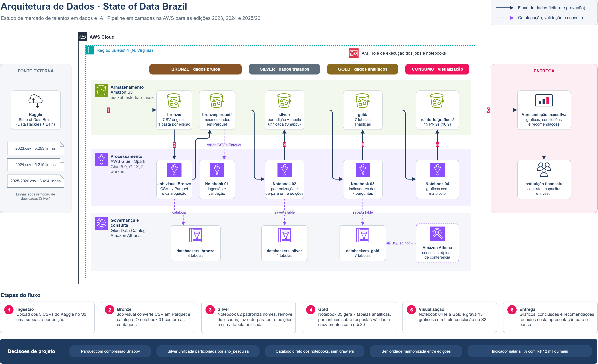

# 📊 Tech Challenge - Data Analytics [FASE 03]

## Dados, IA e talentos no Brasil: pipeline Bronze, Silver e Gold na AWS com a pesquisa State of Data Brazil



## 📌 Sobre o Projeto

Este projeto faz parte da **Fase 03 do Tech Challenge** do curso de Data Analytics. O objetivo é construir um **pipeline de dados na AWS**, organizado em camadas **Bronze, Silver e Gold**, a partir da pesquisa **State of Data Brazil** (Data Hackers + Bain & Company), e usar as tabelas analíticas para responder a perguntas de negócio sobre o mercado brasileiro de dados.

**Cenário:** um banco contratou o grupo como analistas e cientistas de dados para entender o mercado de talentos de dados e IA no Brasil, como apoio às decisões de contratação, remuneração e adoção de IA. O relatório executivo é dirigido a esse cliente.

São usadas três edições da pesquisa:

| Edição | Registros (Silver) |
|---|---|
| 2023 | 5.293 |
| 2024 | 5.215 |
| 2025/26 | 3.494 |
| **Total (tabela unificada)** | **14.002** |

## ❓ Perguntas de Negócio

| # | Pergunta | Tabela Gold |
|---|---|---|
| Q1 | Como está estruturado o mercado brasileiro de dados? | `gold_estrutura_mercado` |
| Q2 | Quais perfis profissionais são mais valorizados? | `gold_remuneracao_perfis` |
| Q3 | Qual é o cenário de diversidade de gênero? | `gold_diversidade_genero`, `gold_comparacoes_remuneracao` |
| Q4 | Quais tecnologias têm maior adoção? | `gold_adocao_tecnologias` |
| Q5 | Qual é o índice de adoção de IA? | `gold_adocao_ia`, `gold_comparacoes_remuneracao`, `gold_ia_empresas` |
| Q6 | Há diferenças de remuneração entre regiões e modelos de trabalho? | `gold_comparacoes_remuneracao` |
| Q7 | Quais são as oportunidades e os desafios da IA nas empresas? | `gold_ia_empresas` |

## 🏗️ Arquitetura

O diagrama editável está em [`Arquitetura/arquitetura-state-of-data.drawio`](Arquitetura/arquitetura-state-of-data.drawio) (abrir em [app.diagrams.net](https://app.diagrams.net)).

| Camada | O que acontece | Onde |
|---|---|---|
| 🥉 **Bronze** | CSV original de cada edição no S3 (uma subpasta por ano). Um job visual do Glue converte para Parquet e cataloga; o notebook 01 valida CSV × Parquet | `s3://<bucket>/bronze/` · database `datahackers_bronze` |
| 🥈 **Silver** | Padronização de nomes de colunas, remoção de duplicidades, correção das faixas salariais, de-para entre edições, harmonização de categorias e indicadores de IA. Grava uma tabela por edição e uma tabela unificada | `s3://<bucket>/silver/` · database `datahackers_silver` |
| 🥇 **Gold** | 7 tabelas analíticas em **Spark SQL**, uma por pergunta de negócio | `s3://<bucket>/gold/` · database `datahackers_gold` |
| 📈 **Visualização** | 15 gráficos gerados a partir da Gold, usados no relatório executivo | `s3://<bucket>/relatorio/graficos/` |

O **Glue Data Catalog** registra todas as tabelas (com `saveAsTable` nos notebooks), e o **Athena** foi usado só para consultas rápidas de conferência.

## 📓 Notebooks (AWS Glue Notebooks)

Os notebooks estão em [`Notebooks/`](Notebooks/), numerados na ordem de execução e salvos **com as saídas** da última execução no Glue.

| Ordem | Camada | Notebook | O que faz |
|---|---|---|---|
| 01 | 🥉 Bronze | [`01_bronze_ingestao_catalogacao.ipynb`](Notebooks/01_bronze_ingestao_catalogacao.ipynb) | Confere os CSVs de cada edição no S3, lê com Spark e valida a cópia em Parquet gerada pelo job visual (registros e colunas) |
| 02 | 🥈 Silver | [`02_silver_tratamento_v2.ipynb`](Notebooks/02_silver_tratamento_v2.ipynb) | Tratamento, de-para entre edições e criação de `silver_perfil_profissionais` (particionada por `ano_pesquisa`) |
| 03 | 🥇 Gold | [`03_gold_tabelas_analiticas.ipynb`](Notebooks/03_gold_tabelas_analiticas.ipynb) | Gera as 7 tabelas analíticas em Spark SQL e grava no S3 e no catálogo |
| 04 | 📈 Visualização | [`04_visualizacoes_relatorio.ipynb`](Notebooks/04_visualizacoes_relatorio.ipynb) | Lê a Gold e gera os 15 gráficos do relatório |

Configuração usada em todos: `%glue_version 5.0`, `G.1X`, 2 workers e `%idle_timeout 30`.

### Tabelas Gold

| Tabela | Linhas | Principais colunas |
|---|---|---|
| `gold_estrutura_mercado` | 251 | ano_pesquisa, indicador, categoria, quantidade, total_validas, percentual |
| `gold_remuneracao_perfis` | 88 | ano_pesquisa, cargo, senioridade_harmonizada, respostas, pct_12k_mais, salario_medio_estimado, posicao |
| `gold_comparacoes_remuneracao` | 122 | ano_pesquisa, dimensao, categoria, respostas, pct_12k_mais, salario_medio_estimado |
| `gold_diversidade_genero` | 56 | ano_pesquisa, recorte_tipo, recorte, genero, quantidade, percentual |
| `gold_adocao_tecnologias` | 292 | ano_pesquisa, tema, tecnologia, respondentes, mencoes, percentual, posicao |
| `gold_adocao_ia` | 180 | ano_pesquisa, recorte_tipo, recorte, indicador, percentual |
| `gold_ia_empresas` | 80 | ano_pesquisa, pergunta, opcao, respondentes, mencoes, percentual, posicao |

**Regras usadas em todas as tabelas**
- Percentuais calculados sobre as respostas válidas de cada edição.
- Cruzamentos com menos de 30 respostas são descartados.
- Indicador salarial: % de profissionais com salário de **R$ 12 mil ou mais** (os dados vêm em faixas, não em valores).
- Salário estimado pelo ponto médio da faixa; na faixa aberta (acima de R$ 40.001), usa-se o piso.

## 💡 Principais Achados (2025/26, salvo indicação)

- **Senioridade é o fator que mais pesa no salário:** 61% dos Sênior+ e 76% dos gestores ganham R$ 12 mil ou mais, contra 1,5% dos Júnior.
- **Perfis mais valorizados:** Engenheiro de ML Sênior+ (88%), Gerente/Head (87%) e Diretor/VP (83%).
- **Mercado:** 65% trabalham com carteira assinada (CLT); Analista de Dados é o cargo mais comum (19%).
- **Diversidade:** mulheres são 22% do mercado e 18% da gestão; 37% delas ganham R$ 12 mil ou mais, contra 45% dos homens.
- **Modelo de trabalho:** no remoto, 51% ganham R$ 12 mil ou mais; no presencial, 22%.
- **Tecnologias:** SQL (87,7%) e Python (81,8%) dominam (2024); AWS (48%) e Power BI (59%) lideram em cloud e BI.
- **IA:** o uso passou de 81% (2023) para 98% (2025/26), e a parcela que usa ferramenta paga pela empresa foi de 6% para 42%. Usar IA, sozinho, não diferencia salário.
- **IA nas empresas (gestores):** 38% estão em pilotos sem muitos resultados; as maiores barreiras são falta de expertise (39%) e dados não prontos (37%).

## 📑 Relatório Executivo

O material executivo, com storytelling, os gráficos de cada pergunta, recomendações para o banco e o diagrama da arquitetura no anexo, está em [`Relatório/`](Relatório/). Os gráficos em PNG estão em [`Relatório/Gráficos/`](Relatório/Gráficos/).

## ⚠️ Limitações dos Dados

- Pesquisa da comunidade, com respostas autodeclaradas: não é uma amostra aleatória do mercado.
- Salário informado em faixas: a média é uma estimativa conservadora.
- A edição 2025/26 não pergunta as linguagens usadas no dia a dia; o gráfico de linguagens compara 2023 e 2024.
- As perguntas sobre IA nas empresas são respondidas só por gestores, e "resultados com IA" só existe em 2025/26.
- Amostra pequena na Região Norte (n = 36 em 2025/26).
- Associação não é causa: as comparações salariais não controlam todas as variáveis ao mesmo tempo.

## 🛠️ Tecnologias Utilizadas

- **Armazenamento:** Amazon S3 (data lake em camadas)
- **Processamento:** AWS Glue (job visual e Glue Notebooks), PySpark e Spark SQL
- **Catálogo e consulta:** AWS Glue Data Catalog e Amazon Athena
- **Visualização:** matplotlib
- **Diagrama:** draw.io

## 🚀 Como Reproduzir

1. Baixe os CSVs das edições 2023, 2024 e 2025/26 da pesquisa [State of Data Brazil](https://www.stateofdata.com.br/) (também disponíveis no Kaggle). Os dados brutos não estão versionados neste repositório.
2. Crie um bucket no S3 e envie cada CSV para `bronze/state_of_data_<ano>/` (`2023`, `2024` e `2025_2026`).
3. Crie um job visual no Glue que leia os CSVs e grave em Parquet em `bronze/parquet/state_of_data_<ano>/`, catalogando no database `datahackers_bronze`.
4. Importe os notebooks de [`Notebooks/`](Notebooks/) no AWS Glue Studio, ajuste o nome do bucket na célula de configuração e execute na ordem **01 → 02 → 03 → 04**.

## 📂 Estrutura do Repositório

```
TECH_CHALLENGE_FASE_03
│
├── Arquitetura/
│   ├── arquitetura-state-of-data.drawio
│   └── arquitetura-state-of-data.png
│
├── Notebooks/
│   ├── 01_bronze_ingestao_catalogacao.ipynb
│   ├── 02_silver_tratamento_v2.ipynb
│   ├── 03_gold_tabelas_analiticas.ipynb
│   └── 04_visualizacoes_relatorio.ipynb
│
├── Relatório/
│   ├── relatorio-executivo-state-of-data.pdf
│   └── Gráficos/
│       └── q1_*.png … q7_*.png (15 gráficos)
│
├── .gitignore
└── README.md
```

## 👥 Integrantes

- Alessandra da Silva Ramos
- Beatriz Rosa Pizani
- Fabio Eiji Kato Kato
- Pamela Vilar Coelho
- Vinícius Prado Costa
